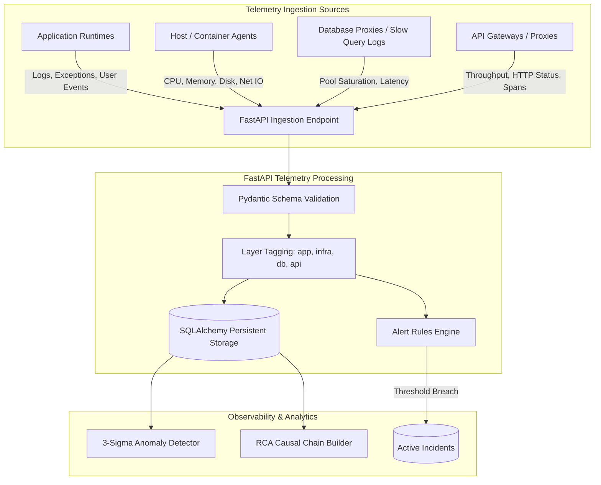
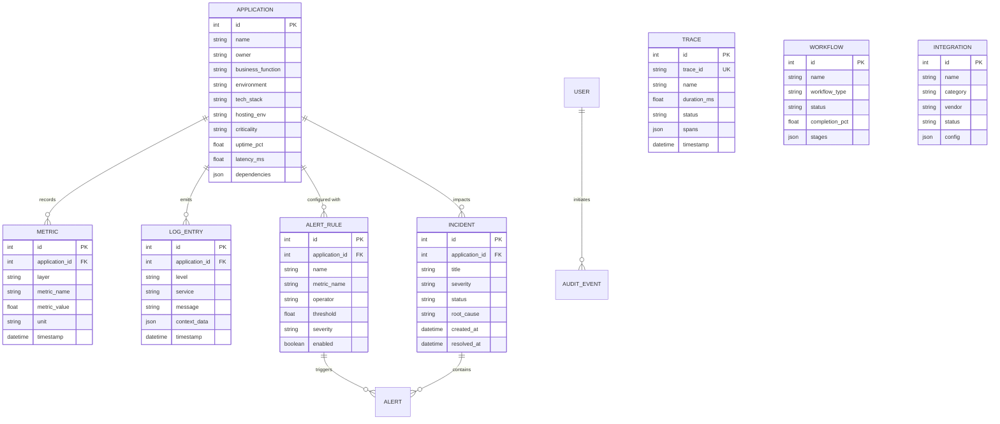

# Open Layer Observability Platform — Architecture Documentation

## 1. System Overview

**Open Layer** is an enterprise-grade Application Observability & Intelligent Monitoring Platform designed to deliver 360-degree real-time visibility across microservices, hybrid-cloud infrastructure, databases, and business workflows.

The system is architected around six core tenets:
1. **Unified 4-Tier Telemetry**: Ingests and correlates metrics across Application, Infrastructure, Database, and API layers into a unified timeline.
2. **Explainable AI Analytics**: Delivers transparent root cause analysis (RCA), anomaly detection, and downtime risk estimation using deterministic statistical models rather than opaque black-box systems.
3. **Enterprise Security & Compliance**: Strict 5-role Role-Based Access Control (RBAC), bcrypt credential hashing, and SOC/SIEM-ready audit trails.
4. **Resilient Data Architecture**: Seamless multi-engine SQLAlchemy abstraction supporting instant zero-dependency SQLite for local development and MySQL/PostgreSQL for production scale.
5. **Cost-Conscious Deployment**: Client-side single-page architecture (SPA) optimized for edge hosting (Vercel) coupled with a lightweight, asynchronous backend (FastAPI).
6. **Business Transaction Context**: Bridges technical telemetry with business KPIs (Loan Origination, UPI Instant Payments, Customer KYC journeys).

---

## 2. High-Level Architecture

```
                      +---------------------------------------+
                      |       Clients & Web Browsers          |
                      +---------------------------------------+
                                          |
                                          | HTTPS / REST
                                          v
+---------------------------------------------------------------------------------+
|                         Edge / CDN Tier (Vercel)                                |
|                                                                                 |
|   +-------------------------------------------------------------------------+   |
|   |                       React 18 SPA (Vite)                               |   |
|   |  - Dashboard (Health, Uptime, Latency, Error Rate)                      |   |
|   |  - Applications Drawer & Dependency Topology Graph                      |   |
|   |  - 4-Tier Telemetry Visualizers                                         |   |
|   |  - Distributed Tracing Waterfall Viewer                                 |   |
|   |  - Natural-Language Log Filter ("failed UPI transactions")              |   |
|   |  - AI RCA Modal with Multi-Hop Causal Chains                            |   |
|   |  - Alert Rules Engine & Incident Lifecycle Manager                      |   |
|   |  - Business Workflow Stepper (Stage Advancement)                        |   |
|   |  - Integrations Catalog (15 Services with Live Test)                    |   |
|   |  - Export Center (RFC 4180 CSV / Excel Downloads)                       |   |
|   +-------------------------------------------------------------------------+   |
+---------------------------------------------------------------------------------+
                                          |
                                          | JSON over HTTPS
                                          v
+---------------------------------------------------------------------------------+
|                     Application Tier (FastAPI Async Core)                       |
|                                                                                 |
|   +-------------------------------------------------------------------------+   |
|   |                     Security & Authentication Middleware                |   |
|   |  - Native Bcrypt Hashing | JWT Bearer Authentication (HS256)            |   |
|   |  - RBAC Scope Enforcement (Admin, SRE, DevOps, Developer, Viewer)       |   |
|   +-------------------------------------------------------------------------+   |
|                                         |                                       |
|   +-------------------------------------------------------------------------+   |
|   |                             API Routers                                 |   |
|   |  - /api/auth          : Tokens, Users, Role Profile                     |   |
|   |  - /api/applications  : CRUD, Registration, Dependency Inventory        |   |
|   |  - /api/observability : Dashboard, Telemetry, Logs, Traces, Alerts      |   |
|   |  - /api/business      : Workflows, Integrations, 6 Report Generators    |   |
|   +-------------------------------------------------------------------------+   |
|                                         |                                       |
|   +-------------------------------------------------------------------------+   |
|   |                   Explainable AI Analytics Engine                       |   |
|   |  - 3-Sigma Anomaly Detection (Latency, CPU, Error Spikes)               |   |
|   |  - Graph-Based Root Cause Analysis (Confidence % + Remediations)        |   |
|   |  - Capacity & Downtime Risk Forecasting Heuristics                      |   |
|   +-------------------------------------------------------------------------+   |
+---------------------------------------------------------------------------------+
                                          |
                                          | SQLAlchemy 2.0 ORM
                                          v
+---------------------------------------------------------------------------------+
|                            Persistence Tier                                     |
|                                                                                 |
|   +---------------------------+       +-------------------------------------+   |
|   |      SQLite (Dev/Test)    |  OR   |     MySQL 8.0 / PostgreSQL 15+      |   |
|   |  - Zero-config local db   |       |  - Managed Cloud RDS / Supabase     |   |
|   |  - Single-thread safe     |       |  - Connection pooling (Pool size 10)|   |
|   +---------------------------+       +-------------------------------------+   |
+---------------------------------------------------------------------------------+
```

---

## 3. Four-Tier Telemetry Ingestion Flow

The platform ingests, tags, and stores telemetry across four discrete layers:



### Telemetry Layers Breakdown:
1. **Application Layer (`layer="app"`)**: Measures error rates, thread states, request execution times, and unhandled exception traces.
2. **Infrastructure Layer (`layer="infrastructure"`)**: Gathers host and container telemetry including CPU percentage, RAM allocation, disk capacity, and network traffic.
3. **Database Layer (`layer="database"`)**: Tracks connection pool health, slow query durations (>500ms), and query execution latency.
4. **API Layer (`layer="api"`)**: Monitors gateway-level metrics including HTTP status distributions (2xx, 4xx, 5xx), response latencies, and transaction throughput.

---

## 4. Explainable AI & Analytics Architecture

Rather than relying on uninterpretable neural networks or third-party paid AI APIs, Open Layer employs **deterministic, statistical AI heuristics**:

```
+-----------------------------------------------------------------------------------+
|                        Statistical AI & RCA Engine                                |
+-----------------------------------------------------------------------------------+
  1. Anomaly Detection:
     - Calculates rolling mean (μ) and standard deviation (σ) over rolling window.
     - Threshold breach if Metric Value > (μ + 2.5σ) or Metric Value > Critical Ceiling.
     - Generates anomaly record with baseline value, observed value, and deviation %.

  2. Root Cause Analysis (RCA):
     - Correlates degraded application with downstream dependency tree.
     - Scans error logs, database metrics, and infrastructure CPU/Memory in window.
     - Builds multi-hop causal chain:
         [DB Pool Saturation: 98%] --> [Query Latency: 2450ms] --> [API Gateway 504 Timeout]
     - Computes confidence score (0-100%) based on temporal correlation.
     - Emits recommended remediation action (e.g. "Increase connection pool size to 50").

  3. Downtime Risk Prediction:
     - Aggregates resource exhaustion velocity (RAM/CPU delta per minute).
     - Calculates projected time-to-exhaustion (TTE).
     - Assigns qualitative risk tier: LOW, MEDIUM, HIGH, CRITICAL.
+-----------------------------------------------------------------------------------+
```

---

## 5. Distributed Tracing Design

Distributed traces capture cross-boundary requests as they traverse client apps, gateways, services, and databases:

- **Trace Model**:
  - `trace_id`: Globally unique transaction identifier (e.g. `tr-upi-78213-9021`).
  - `name`: Human-readable workflow description (e.g. `UPI Peer-to-Peer Transfer`).
  - `duration_ms`: Total end-to-end execution latency.
  - `status`: `success`, `error`, or `critical`.
  - `spans`: JSON array of ordered execution spans containing:
    - `id`: Span identifier (e.g. `sp-1`).
    - `service`: Microservice name (e.g. `UPI Core Switch`).
    - `endpoint`: Protocol and path (e.g. `POST /api/v2/transfer`).
    - `duration_ms`: Duration of span in milliseconds.
    - `status`: Execution outcome (`success` or `failed`).
    - `attributes`: Key-value metadata (HTTP headers, query strings, SQL statements).

The frontend renders these spans in an interactive waterfall chart, highlighting failed spans in crimson with stack traces.

---

## 6. Security Architecture & RBAC

The platform adheres to zero-trust security practices:

### Role-Based Access Control (RBAC) Matrix

| Capability | Admin | SRE | DevOps | Developer | Viewer |
|---|:---:|:---:|:---:|:---:|:---:|
| View Dashboard & Telemetry | Yes | Yes | Yes | Yes | Yes |
| Centralized Log Search | Yes | Yes | Yes | Yes | Filtered |
| Trace Inspection | Yes | Yes | Yes | Yes | Yes |
| Register / Edit Applications | Yes | Yes | Yes | Read-Only | Read-Only |
| Create / Edit Alert Rules | Yes | Yes | Yes | Read-Only | Read-Only |
| Resolve Incidents | Yes | Yes | Yes | Read-Only | Read-Only |
| Advance Business Workflows | Yes | Yes | Yes | Read-Only | Read-Only |
| Configure Integrations | Yes | Yes | Read-Only | Read-Only | Read-Only |
| Run Integration Tests | Yes | Yes | Yes | Read-Only | Read-Only |
| View & Export Reports | Yes | Yes | Yes | Yes | Read-Only |
| User & Role Management | Yes | Read-Only | Read-Only | Read-Only | Read-Only |
| Security Audit Trail | Yes | Yes | Read-Only | Read-Only | Read-Only |

### Cryptographic Safeguards:
- **Password Storage**: Passwords hashed using `bcrypt.gensalt()` with automatic salt rotation.
- **Session Tokens**: JWT signed with HS256 algorithm and configurable expiration window (`ACCESS_TOKEN_MINUTES`).
- **Audit Logging**: Every sensitive action (`APPLICATION_CREATE`, `ALERT_CREATE`, `INCIDENT_UPDATE`, `WORKFLOW_ADVANCE`, `INTEGRATION_TEST`) creates an unalterable `AuditEvent` in the database.

---

## 7. Database Entity Relationship Diagram



---

## 8. Deployment Topology

The system is configured for low-cost, zero-maintenance cloud hosting:

1. **Frontend (Vercel)**:
   - Built with Vite into static HTML/CSS/JS artifacts (`dist/`).
   - Served globally via Vercel's Edge Network with automatic Brotli compression.
   - SPA routing handled via `vercel.json` rewrites.
2. **Backend (Container / Serverless / VPS)**:
   - Executed as an asynchronous Python ASGI application using Uvicorn.
   - Standard containerization via multi-stage `Dockerfile`.
   - Deployable to Render, Railway, Fly.io, or AWS ECS with minimal resource requirements (256MB RAM).
3. **Database (Tiered)**:
   - Development & automated testing: Embedded SQLite database (`open_layer.db`) with zero external daemon requirements.
   - Production: Managed MySQL 8.0 or PostgreSQL on AWS RDS, Supabase, Neon, or PlanetScale.
